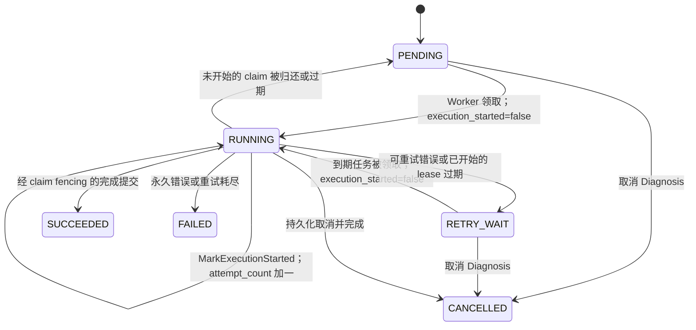
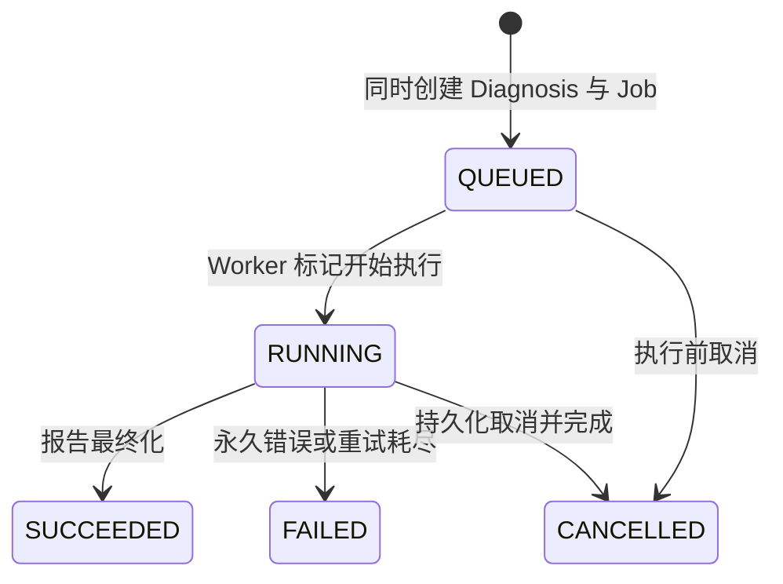
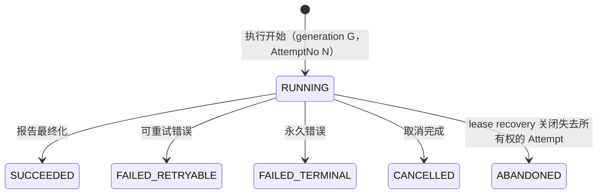

# RepoLens 状态机

本文说明产品流水线、Job 执行、Diagnosis 和 Attempt 的当前状态转换。`AnalysisPipeline` 推进产品阶段；Worker 管理领取和执行流程；Jobs 持久化执行状态及重试、恢复规则。

## Analysis Pipeline

```text
AnalysisRevision: PREPARING → READY / FAILED
  MATERIALIZING_SNAPSHOT
      → BUILDING_CODE_INDEX
      → BUILDING_RETRIEVAL
      → READY
```

失败的 Revision 只能通过显式 Retry 回到 `PREPARING`，并推进 execution generation。阶段完成时会校验当前 Job claim，并在事务中推进 Revision 与 Snapshot/Build lineage。只有 RetrievalBuild 就绪后 Revision 才能进入 `READY`。

```text
RepositorySnapshot: CREATED → MATERIALIZING → READY / FAILED
CodeIndexBuild:     CREATED → BUILDING → READY / FAILED
RetrievalBuild:     CREATED → BUILDING → READY / FAILED
```

`READY` Snapshot 和 Build 表示不可变输入或 artifact。Diagnosis 固定绑定一条通过校验的 `Snapshot → CodeIndexBuild → RetrievalBuild` lineage。

## AnalysisJob 执行



领取只建立执行权，不消耗一次 attempt。分发 handler 前，`MarkExecutionStarted` 会核对 Worker、claim token、generation 和有效 lease，再递增 `attempt_count`。未开始的 claim 过期后回到 `PENDING`，不计入失败尝试；已开始的任务按重试策略恢复。

generation 和 claim-token fencing 会拒绝旧 Worker 对新执行进行开始、续租或终态写入。Jobs 负责持久 Job 状态、重试排期、lease recovery、generation fencing、取消和 Job 终态；Worker 负责领取、续租、标记执行开始及分发 handler。

## DiagnosisRun 生命周期



Diagnosis 业务状态与 `AnalysisJob` 执行状态分开。`RETRY_WAIT` 只属于 Job；自动执行重试等待时 Diagnosis 仍为 `RUNNING`。`SUCCEEDED`、`FAILED` 和 `CANCELLED` 是业务终态。显式 Diagnosis Retry 是用户发起的新操作，会开始新的 execution generation。

## DiagnosisAttempt 生命周期



`ABANDONED` Attempt 不会恢复执行；之后的执行会创建新 Attempt。Provider 是否能自动重试取决于派发和响应是否明确：派发前错误可重试；明确的 HTTP 429/5xx 可使用冻结的 Provider 重试预算；`PROVIDER_OUTCOME_UNKNOWN` 不会自动重放，需要显式 Diagnosis Retry。详见 [Provider 执行语义](provider-execution-semantics.md)。
